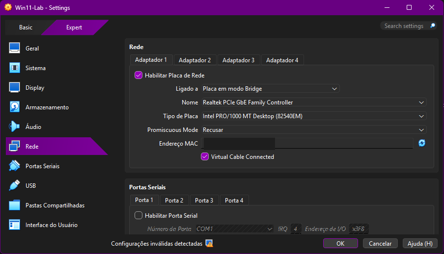
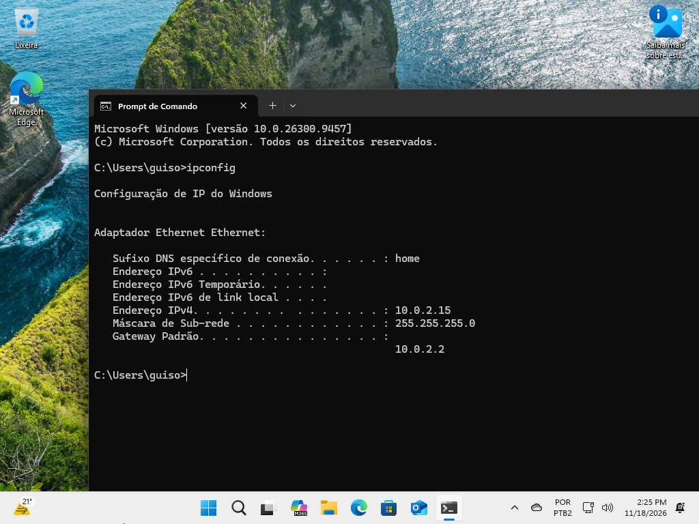
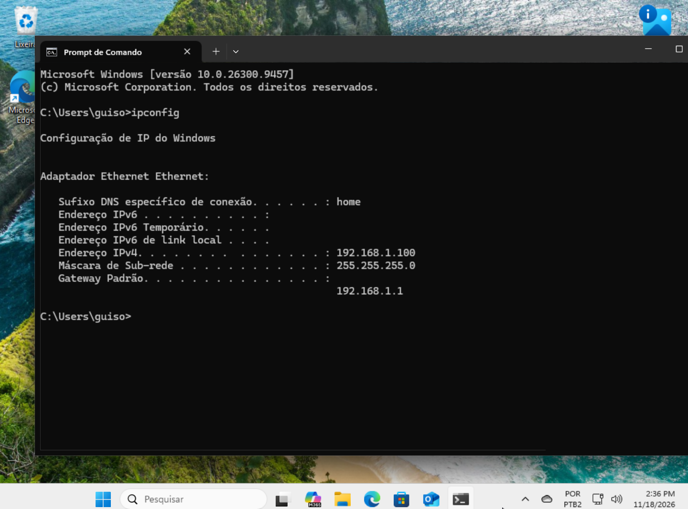
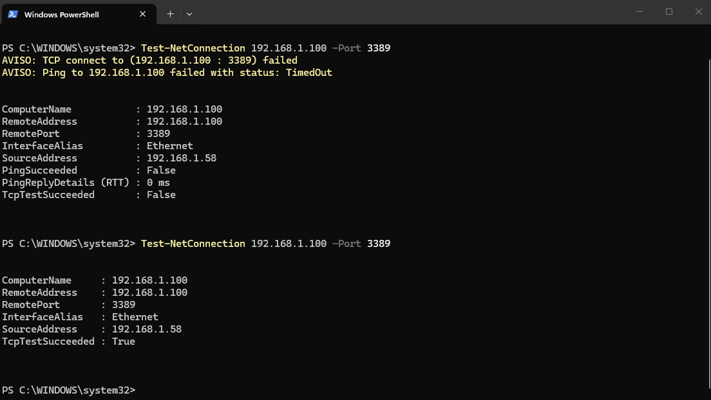
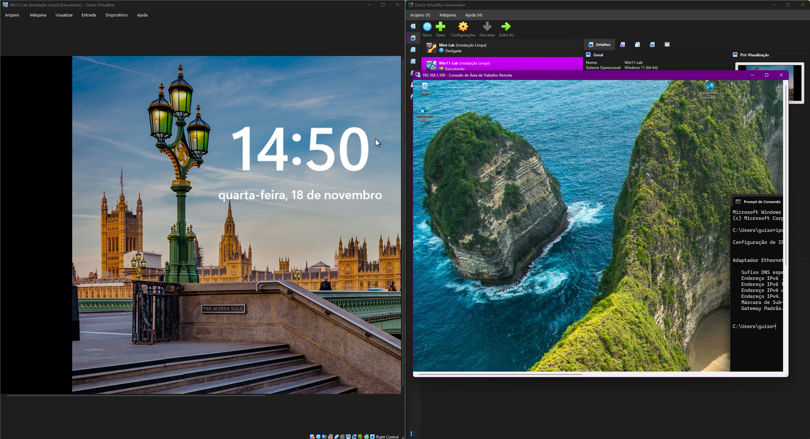
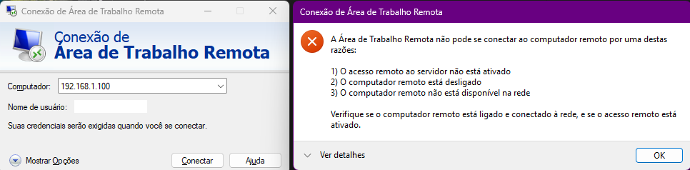
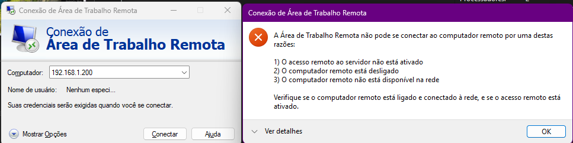
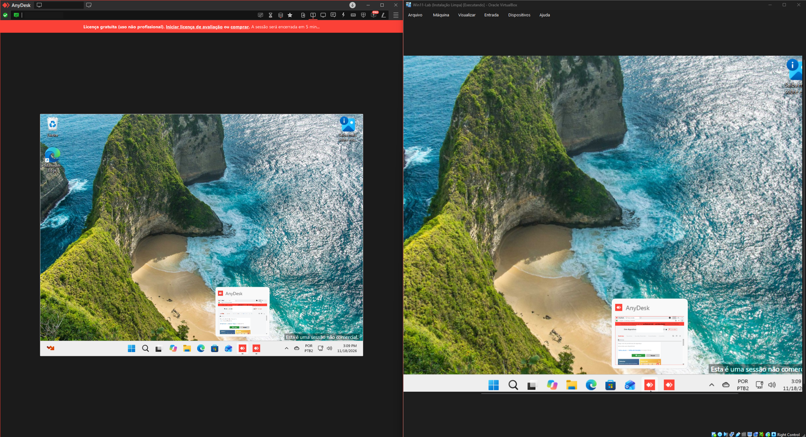
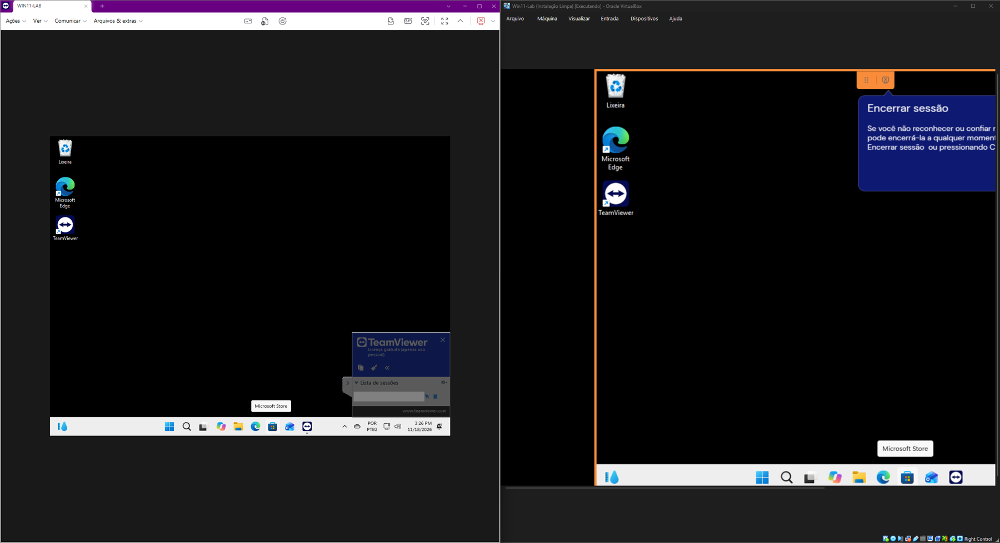

# Laboratório 2: acesso remoto

## Objetivo

Acessar uma máquina Windows remotamente com RDP, AnyDesk e TeamViewer, como um técnico de suporte faz com o computador de um usuário, comparar as ferramentas e documentar os erros mais comuns de conexão. O computador anfitrião acessa a VM Windows 11 Pro do [Laboratório 1](../lab-01-virtualizacao-vms).

## Ambiente

| Item | Detalhe |
| --- | --- |
| Anfitrião (cliente) | Windows 11, conectado por cabo, IP 192.168.1.58 |
| VM (servidor) | Windows 11 Pro, Oracle VirtualBox 7.2.22 |
| Rede da VM | Placa em modo **Bridge** na placa Ethernet do anfitrião |
| IP da VM | 192.168.1.100 (rede 192.168.1.0/24, gateway 192.168.1.1) |

---

# Parte 1: RDP (Área de Trabalho Remota)

Protocolo RDP, porta TCP 3389.

## Passo a passo

### 1. Trocar a rede da VM de NAT para Bridge

No modo NAT, a VM recebe um IP privado do próprio VirtualBox (10.0.2.15) e o anfitrião não consegue alcançá-la. Com a VM desligada, em Configurações, Rede, Adaptador 1, mudei para **Placa em modo Bridge** e escolhi a placa Ethernet do computador. Assim a VM recebe um IP da rede local, como um computador de verdade.





### 2. Ativar a Área de Trabalho Remota na VM

Em Configurações, Sistema, Área de Trabalho Remota, ativei a opção.

### 3. Testar a porta 3389 a partir do anfitrião

```powershell
Test-NetConnection 192.168.1.100 -Port 3389
```

A primeira tentativa falhou (`TcpTestSucceeded : False`). Depois de corrigir a VM, o teste passou (`True`):



### 4. Conectar com mstsc

No anfitrião, executei `mstsc`, informei o IP `192.168.1.100` e entrei com o e-mail e a senha da conta Microsoft da VM (o PIN não funciona no RDP). A VM abriu em uma janela, e a tela física da VM ficou bloqueada, porque o Windows mantém uma sessão ativa por vez.



## Problemas encontrados

### 1. Porta 3389 inacessível (`TcpTestSucceeded : False`)

- **Sintoma:** `Test-NetConnection` retornava `False` na porta 3389 e o ping dava `TimedOut`.
- **Diagnóstico:** confirmei o IP real da VM com `ipconfig` e verifiquei que o anfitrião e a VM estavam na mesma rede (192.168.1.x). Como IP e rede estavam certos, o bloqueio estava dentro da VM (Área de Trabalho Remota, perfil de rede ou firewall). O ping sozinho não é um bom indicador, porque o Windows bloqueia ICMP por padrão. O que vale é o teste TCP na porta.
- **Solução:** corrigi a configuração na VM e o teste passou a retornar `True`.

### 2. IP da VM inalcançável por estar em NAT

- **Sintoma:** a VM aparecia com o IP 10.0.2.15 e o anfitrião não conseguia testar a conexão.
- **Causa:** 10.0.2.15 é o endereço do modo NAT do VirtualBox, que só existe dentro da rede virtual.
- **Solução:** trocar o adaptador para Bridge (passo 1).

### 3. Erro ao conectar com a Área de Trabalho Remota desativada

- **Sintoma:** com a opção desativada na VM, o `mstsc` mostra que não pode se conectar ao computador remoto.
- **Causa:** o acesso remoto não estava habilitado.
- **Solução:** reativar em Configurações, Sistema, Área de Trabalho Remota.



### 4. Erro ao conectar com IP errado

- **Sintoma:** ao tentar `192.168.1.200` (um IP que não existe), a mesma mensagem apareceu.
- **Observação:** a mensagem do `mstsc` é igual para RDP desativado, computador desligado e IP errado. Por isso, o diagnóstico precisa de `ipconfig` no computador remoto e `Test-NetConnection` no cliente para separar as causas.



### 5. `mstsc` executado dentro da própria VM

- **Sintoma:** ao tentar conectar de dentro da VM para ela mesma, apareceu um erro de sessão de console já em andamento.
- **Causa:** o cliente RDP precisa rodar no computador de origem (anfitrião), não no destino.
- **Solução:** fechar e executar o `mstsc` no anfitrião.

---

# Parte 2: AnyDesk

Ferramenta de acesso remoto que não depende de IP nem de configuração de firewall: a conexão passa pelos servidores do AnyDesk e usa um ID de 9 dígitos.

## Passo a passo

1. Na VM, baixei e executei o AnyDesk (anydesk.com) e anotei o ID exibido na janela.
2. No anfitrião, instalei o AnyDesk, digitei o ID da VM no campo de endereço remoto e conectei.
3. A área de trabalho da VM abriu na janela do AnyDesk no anfitrião.



## Observações

- Diferente do RDP, não precisei ativar nenhum recurso do Windows, descobrir o IP nem abrir porta no firewall.
- O AnyDesk mostrou um aviso de licença gratuita (uso não profissional) com a sessão limitada a alguns minutos, e a mensagem "Esta é uma sessão não comercial" na tela remota. Para uso profissional é preciso licença.
- Ao contrário do RDP, a sessão do AnyDesk espelha a tela da VM: a tela física e a tela remota mostram o mesmo desktop ao mesmo tempo, em vez de bloquear a física.

---

# Parte 3: TeamViewer

Outra ferramenta de acesso remoto por ID, com cliente completo em ambos os lados.

## Passo a passo

1. Na VM e no anfitrião, instalei o TeamViewer (uso pessoal, não comercial).
2. Na VM, anotei o ID e a senha exibidos na janela ("Pronto para a conexão").
3. No anfitrião, informei o ID da VM, conectei e digitei a senha.
4. A área de trabalho da VM abriu em uma aba do TeamViewer, e a VM passou a mostrar uma moldura laranja com o aviso "Encerrar sessão", que indica que há uma conexão remota ativa e permite encerrá-la.



## Observações

- A senha do TeamViewer é temporária e muda a cada sessão, e a VM sinaliza visualmente que alguém está conectado, com opção de encerrar.
- O TeamViewer mostrou "Licença gratuita (apenas uso pessoal)": o uso em empresa exige licença.
- Na sessão, o fundo da área de trabalho remota apareceu preto, o que reduz o tráfego de rede.

---

# Comparação entre as ferramentas

| | RDP | AnyDesk | TeamViewer |
| --- | --- | --- | --- |
| Como conecta | Direto, por IP e porta 3389 | Pelos servidores do AnyDesk, por ID | Pelos servidores do TeamViewer, por ID e senha |
| Precisa de IP/firewall | Sim (porta 3389 aberta e rede privada) | Não | Não |
| Configuração no destino | Ativar a Área de Trabalho Remota | Instalar o programa e passar o ID | Instalar o programa e passar ID e senha |
| Funciona pela internet | Só com VPN ou redirecionamento de porta | Sim | Sim |
| Sessão local | Bloqueia a tela física | Espelha a tela, ambos veem | Espelha a tela, com aviso visual e opção de encerrar |
| Licença | Incluso no Windows Pro | Gratuito para uso pessoal | Gratuito para uso pessoal |
| Quando usar | Rede interna de empresa, servidores, gerenciamento de rotina | Suporte rápido a usuário fora da rede, sem mexer em firewall | Suporte a usuário externo, com mais recursos de transferência e sessão |

# O que aprendi

- Diagnóstico de acesso remoto em camadas: IP e rede, porta (`Test-NetConnection`), serviço e firewall no destino.
- NAT isola a VM da rede local, e o modo Bridge faz a VM aparecer na rede como outro computador.
- A mensagem de erro do RDP é a mesma para causas diferentes (serviço desativado, IP errado, máquina desligada), então é preciso testar cada camada para achar a causa.
- RDP é o mais indicado dentro de uma rede corporativa, mas exige configuração. AnyDesk e TeamViewer dispensam IP e firewall, o que os torna práticos para atender usuários fora da rede.
- O RDP bloqueia a tela física da máquina remota durante a sessão, enquanto AnyDesk e TeamViewer espelham a tela.
- Ferramentas de acesso remoto gratuitas são limitadas ao uso pessoal, e o uso profissional exige licença.
